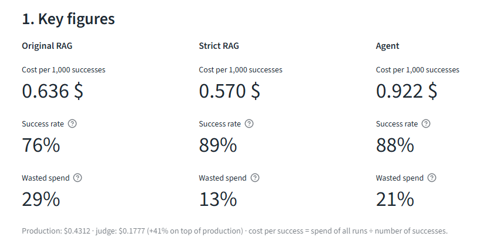
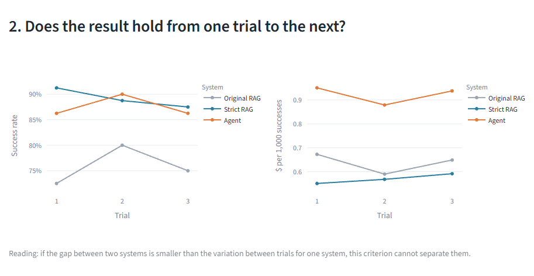
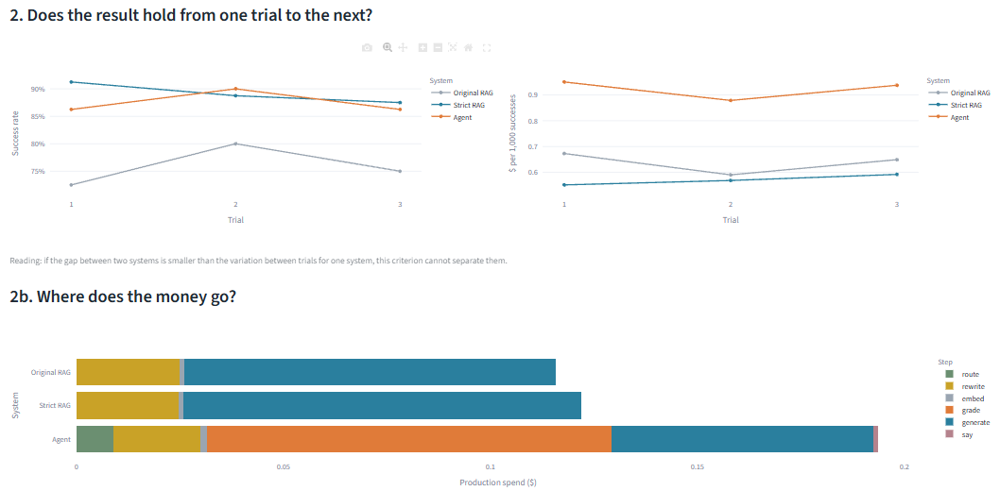

# ai-unit-economics# AI Unit Economics

**How much does one successful answer cost, failures and refusals included, and from what volume and success rate does a RAG or an agent pay for itself?**

This project measures what two AI approaches really cost per answer, then (in progress) lets you query the data in natural language. It keeps two layers strictly apart:

- **Measured** (this page): tokens, cost, success, wasted spend, latency, reconciled against the provider's billing console.
- **Modelled** (in progress): value, ROI and break-even, built on explicit, adjustable assumptions.

## The three systems compared

| System | What it is |
|---|---|
| **Original RAG** | Rewrites the question as an English search query, retrieves the top 5 passages, generates an answer with citations. |
| **Strict RAG** | The same pipeline, with the generation prompt used by the agent. It isolates the effect of the prompt from the effect of the agent's architecture. |
| **Agent** | A LangGraph agent: routes the question (off-topic questions get a polite refusal), rewrites it, retrieves passages and *grades* them. If they are not relevant it loops back to rewrite, at most 2 times, then answers "I don't know". Otherwise it generates the answer. |

All three come from my previous project, [AWS-Agentic-Rag](https://github.com/Titoweb12/Aws-Agentic-Rag), which is left untouched: the measurement wraps its model clients from outside.

## Headline result



80 questions × 3 trials × 3 systems = 720 runs, about 3,500 model calls, $0.61 in total (judge included).

| | Original RAG | Strict RAG | Agent |
|---|---|---|---|
| Success rate | 76 % | 89 % | 88 % |
| Cost per 1,000 successes | $0.64 | $0.57 | $0.92 |
| Share of spend wasted on failed runs | 29 % | 13 % | 21 % |

- Success includes failures and refusals: a wrong refusal or an unsupported claim counts as a failure, and its cost stays in the numerator.
- The agent is not measurably better than the strict RAG on quality (the gap is smaller than the variation between trials) but costs about 1.6× more per success.
- Cost reconciliation: tokens match the provider console exactly (3,176,109); cost is $0.622 computed against $0.62 displayed (the console rounds to the cent).


## How success and cost are defined

**Success** (defined once, in the SQL view `v_outcomes`):
- For a question that has an answer: an answer is given, the judge finds **0 unsupported claims**, and the expected passage was among those used (when the question has one).
- For a question that should be refused (no answer in the corpus, or off-topic): the system refuses.
- An execution error is a failure. The answer's language is recorded but is not part of success.

**Cost of a call** = (input tokens × input price + output tokens × output price) / 1,000,000, using the token counts returned by the provider. Prices are in `config/prices.json`, dated 2026-11-02: Claude Haiku 5.5 at $0.10 / $0.50 per million input / output tokens, Titan Text Embeddings V2 at $0.20 per million input tokens. A missing price gives no cost, never a silent zero. Cache tokens are recorded but not priced.

**Cost per success** = production spend of *all* runs, successes and failures, divided by the number of successes.

**Wasted spend** = production spend of failed runs / total production spend. The two are linked: cost per success = average cost of a successful answer / (1 − wasted share).

**The judge** (an LLM that checks each answer against the passages it was given) exists only for evaluation. Its cost is reported separately from production cost: here it adds about 41 % on top of production spend. It uses the same model family as the generators, which can bias it in their favour.
## How it was measured

**Telemetry.** Every model call is logged to SQLite (`data/telemetry.db`): one row with the system, question, trial, step (route, rewrite, embed, grade, generate, say, judge), model, token counts, latency, cost and status. A thin wrapper replaces the model clients of the RAG project *after* import, so the original code is not modified. Anthropic token counts come from the response's `usage` field; Bedrock (Titan) input tokens come from the response header, which leaves the response body untouched.

**Questions and trials.** 80 questions (50 main, 12 multilingual, 18 held out): 74 have an answer in the corpus, 2 have none, 4 are off-topic. Each question is run 3 times per system, 720 runs in total. The 3 trials show how much results move between identical runs, since model outputs vary. They are not independent samples, so the spread between trials is a rough indicator, not a confidence interval.

**Quality scoring.** A judge model scores each answer during the same run, and only its verdict is stored (refused or not, number of unsupported claims, language), never the answer text. The expected-passage check is plain code, not an LLM call.

**Failures.** Runs that crash count as failures. In this batch one run failed on a validation error (an invalid request to the embedding model, most likely from an empty rewritten query) and was kept as a genuine failure. No infrastructure error (timeout, overload) occurred.

**Reconciliation with billing.** On 25 November 2026 the database held 3,176,109 Anthropic tokens (2,414,457 in, 761,652 out) and $0.622; the provider console showed exactly 3,176,109 tokens and $0.62 (rounded to the cent). Titan costs only $0.004 over 784 calls, too small to check against the AWS bill.

## Limits

- **The judge is Haiku, the same family as the generators**, which can favour them. One unsupported claim is enough to fail an answer, which is strict.
- **Small and narrow**: 80 FAQ-style questions, 3 non-independent trials. Differences smaller than the spread between trials (for example agent vs strict RAG on success rate) are not conclusions.
- **Language is not part of success**, although it is recorded.
- **Partial cost coverage**: only Haiku 5.5 and Titan at the dated prices; cache tokens are not priced; the judge is excluded from production cost.
- **Cost, not value.** Revenue and incremental profit are out of scope. The value, ROI and break-even layer will rely on explicit assumptions and be kept visibly apart from these measurements.

## Dashboard





## Run it

**Dashboard** (needs only `requirements.txt`):

```bash
pip install -r requirements.txt
streamlit run src/dashboard.py
```

The measurement database is not stored in the repository (`data/` is git-ignored), so a fresh clone has nothing to display until a measurement has been run. A self-contained snapshot, without question text, keys or account data, is planned with the Docker deployment.

**New measurement** (needs `requirements-measure.txt`, an Anthropic key, AWS access to Bedrock, and the RAG project cloned in a sibling folder named `Aws-Agentic-Rag`, with its `.env`):

```bash
pip install -r requirements-measure.txt
python -X utf8 src/run_measure.py --set all --trials 3 --run-id lot_A
```

The full batch (720 runs) cost about $0.61. Use `--n 5` to try five questions per set first. Re-running the same `--run-id` skips runs already stored, so an interrupted batch can resume.

**Text report** (read-only):

```bash
python -X utf8 src/report.py lot_A --day 2026-11-25
```

## Repository layout

```
config/prices.json        dated model prices
src/telemetry/            pricing, SQLite store, client wrapper
src/run_measure.py        runs the three systems and the judge
src/report.py             SQL report and billing reconciliation
src/dashboard.py          Streamlit dashboard (measured layer)
tests/                    checks for the store and the wrapper
data/                     telemetry.db (git-ignored)
```

## Status

Done: telemetry, measurement batch, reconciliation, measured dashboard. Next: a small simulator for cost variants, the modelled layer (value, ROI, break-even), a natural-language analysis agent over the database (read-only SQL), and a Docker deployment.